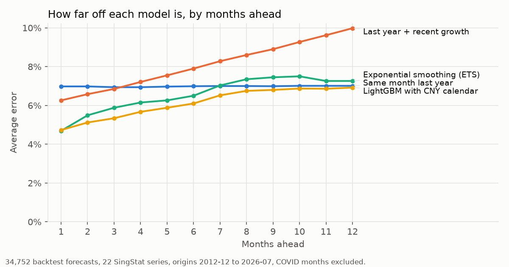
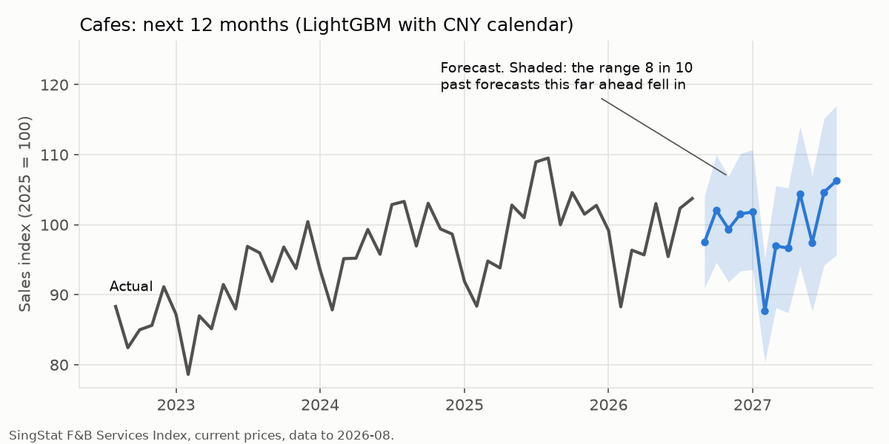

# sg-retail-demand-forecast

**Sales forecasts for 22 Singapore retail and F&B sectors, 1 to 12 months ahead,
tested honestly against the rule of thumb small businesses already use: "same month
last year".** For a café, minimart or fashion shop planning stock, staff and cash.

The best model, one LightGBM model across all sectors that knows when Chinese New
Year falls, is **13% more accurate than "same month last year"** and wins on 18 of
22 sectors. It is scored on 34,752 forecasts made the way they would have been at
the time, from December 2012 to July 2026.



## What was tested, and how

The rules were written down and committed **before any model was run**
([`docs/PROTOCOL.md`](docs/PROTOCOL.md); it is the first commit in the history).
That stops the test being bent to suit whichever model looks good.

- **Data:** SingStat Retail Sales Index and F&B Services Index, monthly, at current
  prices (the money businesses actually take in), up to August 2026.
- **Backtest:** at the end of every month from December 2012, each model forecasts
  the next 12 months using only data available then. This is repeated 164 times
  and every forecast is compared with what happened.
- **Four models, fixed in advance:**

| Model | Idea |
|---|---|
| Same month last year | the baseline: what a shop owner already does |
| Last year + recent growth | the baseline, scaled by the past year's growth |
| Exponential smoothing (ETS) | a classic statistical forecaster, one per sector |
| LightGBM with CNY calendar | one machine-learning model across all 22 sectors. It learns how far this year will differ from last year, from recent growth and from **where Chinese New Year falls** |

## Results

Average error (how far the forecast was from actual sales), COVID months left out:

| Model | Error | Beats the baseline on | Verdict |
|---|---|---|---|
| Same month last year | 7.0% | — | baseline |
| Last year + recent growth | 8.0% | 3 of 22 sectors | **worse** than the baseline |
| Exponential smoothing | 6.5% | 14 of 22 | beats the baseline |
| **LightGBM with CNY calendar** | **6.1%** | **18 of 22** | **best** |

What the numbers say, in plain terms:

- **The gain is mostly short-term.** One month ahead, LightGBM misses by 4.7%
  against 7.0% for the baseline. Twelve months ahead, both miss by about 7%. For
  next month's stock order, use the model; for next year's budget, last year's
  figure is almost as good.
- **Chinese New Year is where the baseline breaks.** CNY moves between January and
  February, so "same month last year" compares festive spending with an ordinary
  month. In January and February it misses by 9.7%; LightGBM, which is told where
  CNY falls, misses by 7.3%.
- **Extrapolating last year's growth makes forecasts worse,** and more so further
  ahead (10% error at 12 months). Growth doesn't carry on in a straight line.
- **Four sectors are better served by the simple rule:** minimarts and convenience
  stores, furniture, optical goods and books, and recreational goods. There,
  LightGBM is slightly worse than "same month last year", and the dashboard shows
  each sector's own track record.
- **COVID broke every model** (44% to 50% error on February 2020 to December 2021).
  That is why it is reported separately instead of being averaged in.



## How sure is a forecast? The ranges, including what went wrong

Every forecast comes with an **80% range**: the spread that 8 in 10 past forecasts at
the same distance ahead fell within.

The protocol set a test for these ranges: build them from errors up to 2019, then
check they contain 70% to 90% of actuals from 2022 on. **They failed: LightGBM's
ranges caught 66%, and the baseline's 63%.** The reason shows up in the errors by year:

| Year forecast | 2013-19 (typical) | 2022 | 2023 | 2024 | 2025 | 2026 |
|---|---|---|---|---|---|---|
| Median error, LightGBM | 2.3% to 5.1% | **10.7%** | 4.9% | 3.3% | 3.7% | 3.0% |

In 2022, "last year" meant COVID-hit 2021, so every method that starts from last
year was badly off for a year. Ranges learned from calm pre-COVID years were too
narrow for that.

The published ranges are therefore built from **all** non-COVID errors, including
2022 and 2023. A check added after seeing the results (so it carries less weight
than the protocol's): ranges built from errors up to 2023 caught **87%** of actuals
in 2024 to 2026. That is slightly wider than 80%, so the ranges err on the side of
caution.

## Use it

```bash
pip install -r requirements.txt
streamlit run app.py      # pick your sector: chart, monthly table, 80% range, track record
```

The dashboard reads the committed `results/`, so it runs instantly. To rebuild:

```bash
python scripts/ingest.py  # refresh data/series.csv from SingStat
python run.py             # full backtest + forecasts, ~10 minutes
python scripts/charts.py  # redraw docs/*.png
pytest                    # 21 tests, including the dashboard
```

## Code

| File | What it does |
|---|---|
| `forecast/models.py` | the four models; LightGBM predicts the change against the same month last year, so it learns only the correction to the baseline |
| `forecast/calendar.py` | Chinese New Year dates 1990 to 2028: share of the 14-day run-up and of the holiday in each month |
| `forecast/backtest.py` | rolling-origin backtest, errors, skill, the protocol's "beats the baseline" rule |
| `forecast/intervals.py` | 80% ranges from backtest errors, and the calibration check |
| `tests/test_forecast.py` | includes **look-ahead tests**: wrecking every month after the forecast date must not change a single forecast |

## Outputs (`results/`)

| File | Contents |
|---|---|
| `forecasts.csv` | next 12 months for every sector and model, with 80% ranges |
| `headline.csv`, `by_horizon.csv`, `per_series.csv`, `by_season.csv` | the tables above |
| `backtest.parquet` | all 40,548 backtest forecasts, for anyone who wants to check |
| `summary.json` | run metadata and the calibration results |

Data: [SingStat Table Builder](https://tablebuilder.singstat.gov.sg/) tables
M602121 and M602131, under the Singapore Open Data Licence.
